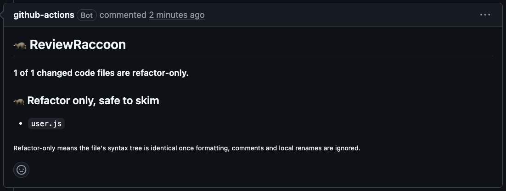
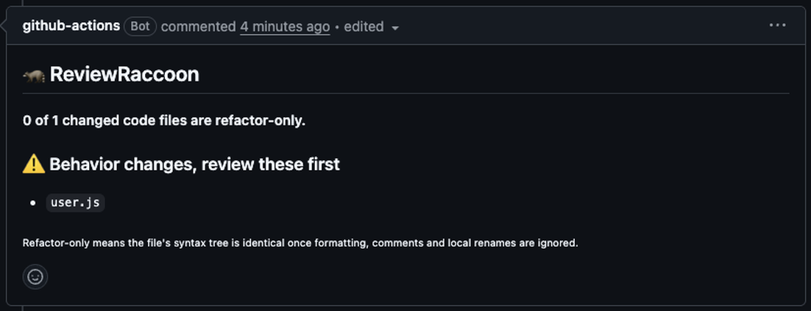

# 🦝 ReviewRaccoon

[](https://github.com/TheRealJahaan/reviewraccoon/actions/workflows/test.yml)

**Know which files in a pull request you can skim.**

A 40-file pull request often has only 3 files that really change what the code does. The rest is renames, reformatting and moved braces, but a reviewer can't tell which is which without reading everything.

ReviewRaccoon reads every changed JavaScript and TypeScript file and posts one comment that splits them into two lists:

- ⚠️ **Behavior changes.** Review these first.
- 🦝 **Refactor only.** The code does exactly the same thing as before. Safe to skim.

<p>
  
  
</p>

It updates the same comment every time you push, so it never spams the pull request.

## Not a guess. A proof.

ReviewRaccoon doesn't use AI. It turns the old and new version of each file into a syntax tree, strips out everything that can't change behavior, and compares the two trees. If they match, the file is refactor-only. If anything else differs, it's flagged.

**Ignored (counts as refactor):**
- Formatting, whitespace, semicolons and quote style
- Comments
- Braces around a single statement
- Renaming local variables, parameters, functions, classes and imports, scope by scope

**Always flagged (counts as behavior change):**
- Any change to logic, values, strings or calls
- Renaming anything other files can see: exports, object keys, properties, class methods
- A rename that makes a name point at a different variable
- Type changes in TypeScript

When it isn't sure, it flags the file. A false alarm costs you a minute. A missed bug costs much more.

## Your code never leaves GitHub

ReviewRaccoon runs inside your own GitHub Actions runner. There's no server, no account, no API key and no AI model. Your code is never sent anywhere.

## Install in 1 minute

Add this file to your repository as `.github/workflows/reviewraccoon.yml`:

```yaml
name: ReviewRaccoon

on:
  pull_request:
    types: [opened, synchronize, reopened]

permissions:
  contents: read
  pull-requests: write

jobs:
  sort:
    runs-on: ubuntu-latest
    steps:
      - uses: TheRealJahaan/reviewraccoon@v1
```

Then open a pull request that changes a `.js`, `.jsx`, `.ts`, `.tsx`, `.mjs` or `.cjs` file. The raccoon comments within about 20 seconds.

## Limitations

- JavaScript and TypeScript only for now.
- Each file is compared on its own, so code moved from one file to another shows up as a deletion and a new file.
- Pull requests from forks get a read-only token from GitHub, so the raccoon can't comment on them. It puts the same report on the run's summary page instead.
- Some rewrites that do the same thing, such as turning an arrow function into a `function`, are flagged on purpose.

## Run the tests

```bash
npm install
npm test
```

## Roadmap

- Highlight the exact lines that changed behavior
- Detect code moved between files
- Python support
- Comments on pull requests from forks

Found a refactor it flagged, or a behavior change it missed? [Open an issue](https://github.com/TheRealJahaan/reviewraccoon/issues) with the before and after code.

## License

MIT
