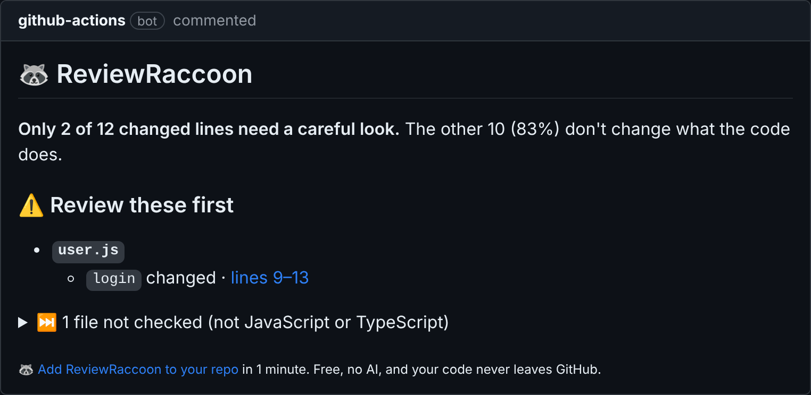

# 🦝 ReviewRaccoon

[](https://github.com/TheRealJahaan/reviewraccoon/actions/workflows/test.yml)
[](https://github.com/marketplace/actions/reviewraccoon)

**See exactly which functions a pull request changes. Prove the rest is safe.**

ReviewRaccoon reads every changed JavaScript and TypeScript file in a pull request and posts one comment that says:

- **Where behavior changed:** the functions, classes and methods that now do something different, with links to their lines.
- **How much that is:** "Only 2 of 12 changed lines need a careful look."
- **What's provably safe:** files where only formatting, comments or local names changed.

<p align="center">
  
</p>

It updates the same comment on every push, so it never spams the pull request.

## What 1,000 real pull requests showed

I built ReviewRaccoon because I thought most of a pull request was noise: renames, reformatting and moved code. Then I measured it. The [scanner](#measure-your-own-repo) ran ReviewRaccoon over the last 100 merged pull requests of 10 big open-source projects in November 2026.

| Repo | Changed lines of JS and TS | Refactor-only |
| --- | ---: | ---: |
| facebook/react | 15,515 | 2% |
| vercel/next.js | 25,379 | 4% |
| microsoft/vscode | 39,080 | 1% |
| microsoft/TypeScript | 24,203 | 1% |
| vitejs/vite | 10,903 | 2% |
| sveltejs/svelte | 14,182 | 6% |
| angular/angular | 8,713 | 5% |
| prettier/prettier | 4,133 | 5% |
| eslint/eslint | 8,601 | 5% |
| nodejs/node | 19,451 | 3% |
| **All 10** | **170,160** | **3%** |

I was wrong. In these projects, 97% of changed lines change what the code does. Refactors ship as their own pull requests: only 11 of the 666 pull requests that touched JavaScript or TypeScript were pure refactors, and the biggest was 11 lines.

The count is strict. Inside a function that changed, every changed line counts as a change, even a rename on the next line, so the real refactor share is somewhat higher. Pull requests with more than 100 code files were skipped (8 of the 1,000).

So ReviewRaccoon doesn't promise to hide most of your diff. It points you at the exact functions that behave differently, and when a change really is refactor-only, it proves it, so you can approve it in seconds.

## Not a guess. A proof.

ReviewRaccoon doesn't use AI. It turns the old and new version of each file into a syntax tree, strips out everything that can't change behavior, and compares the two trees, piece by piece. A piece is only called safe when it is provably the same.

**Ignored (safe to skim):**
- Formatting, whitespace, semicolons and quote style
- Comments
- Braces around a single statement
- Renaming local variables, parameters, functions, classes and imports, scope by scope
- Moving a function or class to another place in the same file

**Always flagged (needs a careful look):**
- Any change to logic, values, strings or calls
- Renaming anything other files can see: exports, object keys, properties, class methods
- A rename that makes a name point at a different variable
- Code that now runs in a different order
- Type changes in TypeScript

When it isn't sure, it flags the code. A false alarm costs you a minute. A missed bug costs much more.

## Your code never leaves GitHub

ReviewRaccoon runs inside your own GitHub Actions runner. There's no server, no account, no API key and no AI model. Your code is never sent anywhere.

## Install in 1 minute

Add this file to your repository as `.github/workflows/reviewraccoon.yml`:

```yaml
name: ReviewRaccoon

on:
  pull_request:
    types: [opened, synchronize, reopened]

permissions:
  contents: read
  pull-requests: write

jobs:
  sort:
    runs-on: ubuntu-latest
    steps:
      - uses: TheRealJahaan/reviewraccoon@v1
```

Then open a pull request that changes a `.js`, `.jsx`, `.ts`, `.tsx`, `.mjs` or `.cjs` file. The raccoon comments within about 20 seconds.

## Measure your own repo

The scanner runs ReviewRaccoon over the recent merged pull requests of any public repo and tells you how many changed lines actually changed behavior. It's how the table above was made.

```bash
git clone https://github.com/TheRealJahaan/reviewraccoon
cd reviewraccoon
npm install
GITHUB_TOKEN=$(gh auth token) node scripts/scan.js facebook/react vercel/next.js --prs 100
```

It prints a summary for each repo and saves every pull request's numbers to `scan-results.json`. If your numbers look very different from the table, [open an issue](https://github.com/TheRealJahaan/reviewraccoon/issues) and share them.

## Limitations

- JavaScript and TypeScript only for now.
- Each file is compared on its own, so code moved from one file to another shows up as a deletion and a new file.
- Inside a function that changed, every changed line counts as needing a look, even a rename on the next line.
- Some rewrites that do the same thing, such as turning an arrow function into a `function`, are flagged on purpose.
- Pull requests from forks get a read-only token from GitHub, so the raccoon can't comment on them. It puts the same report on the run's summary page instead.

## Run the tests

```bash
npm install
npm test
```

## Roadmap

- Flag the exact statements that changed inside a function, not the whole function
- Python, Go and Java support
- Detect code moved between files
- Optional AI review of only the lines that changed behavior, with your own API key
- Comments on pull requests from forks

Found a refactor it flagged, or a behavior change it missed? [Open an issue](https://github.com/TheRealJahaan/reviewraccoon/issues) with the before and after code.

## License

MIT
